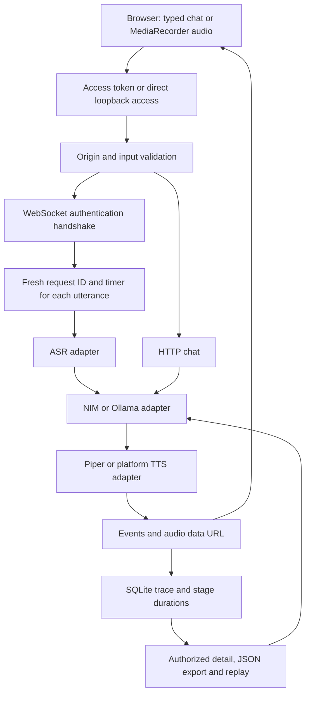

# Realtime Voice AI Reliability Lab — project brief

Repository: https://github.com/ramshetty01/realtime-voice-ai-lab

## Purpose and present status

A local chained voice-assistant lab that turns browser audio into text, generates a
reply, synthesizes audio, and records request traces for debugging. It demonstrates
API/WebSocket integration, adapter boundaries, failure handling and trace replay.
It is not a deployed production service or a validated low-latency speech model.
The current workflow buffers each utterance; it does not provide true duplex audio,
barge-in, streaming model tokens or WebRTC speech-to-speech inference.

## Actual technology stack

| Component | Implementation |
|---|---|
| UI | Next.js App Router 15.5.29, React 19.2.7, TypeScript 5.9.3, CSS |
| Browser audio | MediaRecorder, Web Audio analyser for silence stop, HTMLAudioElement |
| Service | Python >=3.11, FastAPI, Uvicorn, Pydantic |
| Transport | HTTP JSON chat/replay/export and WebSocket audio/events |
| ASR | Optional faster-whisper; development transcript fallback otherwise |
| Text model | NVIDIA NIM-compatible chat-completions endpoint, then local Ollama fallback |
| TTS | Piper executable/model, macOS say/afconvert fallback, then a silent WAV fallback |
| Persistence | SQLite request/trace table; optional recording files |
| Verification | pytest, FastAPI TestClient including actual WebSocket sessions, Next build, npm audit, optional Playwright smoke |
| Packaging | Python pyproject, npm lockfile, Dockerfiles/Compose, GitHub Actions |

These adapters exist in the code. This maintenance run did not validate NVIDIA NIM,
faster-whisper transcription quality, Piper output quality, or a complete real-microphone
conversation. No paid inference was used. Backend dependency ranges remain unpinned.

## Architecture and workflow



Typed requests contain a message and bounded history. Voice clients first send
`{"type":"authenticate","token":"..."}` and wait for `session_ready`. Each voice
turn then sends `client_audio_ready` metadata followed by binary audio. The backend
creates a unique turn ID, validates audio, runs ASR -> LLM -> TTS in worker threads,
collects events and stores a trace. Metadata is cleared between utterances.

Stage events and `llm_token` events are currently buffered until the pipeline finishes;
they should not be described as live streaming. A failed ASR produces a failure terminal
event rather than a later success. TTS failures can leave a degraded text response.
Model timeouts are marked degraded. Adapter-internal development fallbacks can still
be marked completed; follow-up issue #236 tracks explicit fallback provenance.

## Access and data boundaries

`VOICE_API_TOKEN` protects chat, stored transcripts, exports and replay. The browser
keeps this access token only in page memory, uses HTTP bearer headers and the initial
WebSocket frame, and never places it in URL query strings. It is separate from the
server's NVIDIA key. Exact configured browser origins are checked for both transports.

Without a token, `VOICE_LOCAL_ONLY=true` allows only loopback peers with a localhost,
127.0.0.1 or ::1 Host. Forwarded headers do not establish trust. Do not expose this mode
through a reverse proxy: shared access must configure a token. Docker requires a token
and publishes ports on loopback. Shared-token access is single-owner access; it does
not isolate one account's traces from another account's traces.

HTTP bodies are limited to 256 KiB, chat history to 32 items, metadata to 32 KiB, and
trace pagination to 1–100. Audio size is checked before ASR. Transport-level frame and
connection limits still need deployment configuration. Recordings default off, but
transcripts remain in SQLite; retention defaults do not establish a privacy program.

## Setup and verification

```sh
cp .env.example .env
# For shared/Docker access, set a private VOICE_API_TOKEN and exact CORS_ORIGINS.
cd backend
python3.12 -m venv .venv
. .venv/bin/activate
pip install -e '.[dev]'
pytest -q
# Export your .env settings, then bind locally:
uvicorn app.main:app --host 127.0.0.1 --port 8000
```

In another terminal: `cd frontend && npm ci && npm run dev`. Open the browser and
enter the lab token under API access if configured. `npm run build` checks the
production frontend build. `npm audit --audit-level=moderate` checks known npm advisories.

Verification on 2026-11-11:

- Baseline: 37 backend tests passed; production frontend build passed.
- After fixes: 54 backend tests pass, including authenticated HTTP/WS, untrusted
  origin/Host denial, two turns on one socket, empty/malformed frames, metadata reset,
  bounded inputs and safe terminal failures.
- Frontend production build passes after dependency updates. npm audit changed from
  five findings (one critical, three high, one moderate) to zero known findings.
- Provider-free browser smoke passes authenticated socket connection, typed chat,
  trace inspection and protected JSON download. Screenshots were inspected locally.
  The response came from the missing-Ollama fallback and the audio was a silent WAV;
  this is access/integration evidence, not live voice-quality evidence.
- CI explicitly installs the Python dev extra and checks frontend build/audit.

Optional `scripts/browser_smoke.py` uses Playwright against an already-running app.
Set `VOICE_SMOKE_TOKEN` in the process environment, not command arguments. Its requests
may use whichever model adapters the target service has configured.

## Issues addressed and remaining work

- [#233 Access/origin protection](https://github.com/ramshetty01/realtime-voice-ai-lab/issues/233)
- [#234 Per-turn traces and terminal status](https://github.com/ramshetty01/realtime-voice-ai-lab/issues/234)
- [#235 Frontend dependency updates](https://github.com/ramshetty01/realtime-voice-ai-lab/issues/235)

Still open:

- [#236 Bounded workers and explicit fallback provenance](https://github.com/ramshetty01/realtime-voice-ai-lab/issues/236): `wait_for(to_thread(...))` does not cancel underlying work. Add bounded admission and worker/process lifecycle control, plus strict adapter mode.
- [#42 Actual NVIDIA NIM verification](https://github.com/ramshetty01/realtime-voice-ai-lab/issues/42) and [#61 End-to-end conversation demo](https://github.com/ramshetty01/realtime-voice-ai-lab/issues/61) require genuine runtime evidence.
- Add account identity/trace ownership, TLS/WSS, distributed quotas, deletion/retention policy and workload testing before public multi-user deployment.
- Pin/audit Python runtime dependencies and improve runtime readiness beyond configuration checks.
- Test real microphones/browser codecs, language/accent robustness, latency percentiles and adapter failures on deployment hardware.

## Resume and interview use

Truthful examples to adapt after understanding the code:

- Built a Python/FastAPI and Next.js voice-assistant reliability lab with staged ASR/LLM/TTS adapters, request-level timing, SQLite trace inspection and replay.
- Hardened HTTP/WebSocket access and fixed per-utterance trace identity and failure reporting; verified behavior with 54 backend tests and an authenticated browser integration check.
- Updated vulnerable frontend dependencies and added audit enforcement, reducing the recorded npm audit from five findings to zero known findings.

Be ready to explain why this is a chained, buffered pipeline rather than true realtime
speech-to-speech; why CORS is not authentication; how a shared token differs from tenant
authorization; why thread timeouts do not stop model work; and why a successful fallback
response must not be presented as a validated speech-quality result. Do not claim
production users, accuracy, latency improvements or end-to-end live quality not measured.
